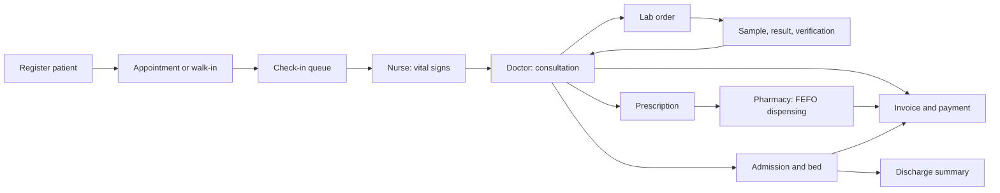
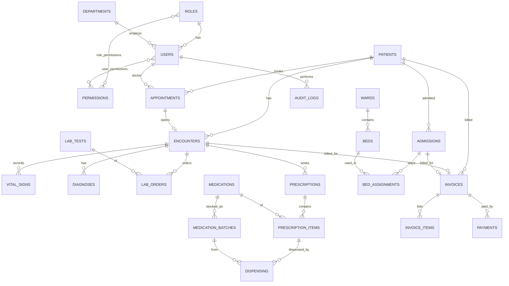

# Integrated Hospital Management System (HMS)

A role-based hospital information system for an Ethiopian hospital: patient registration, appointments, OPD consultations, laboratory, pharmacy and drug stock, billing in Ethiopian Birr, wards and admissions, role dashboards, reports, and administration. English and Amharic, with the Ethiopian calendar.

University / internship project by **<your name>**.

## Features

| Area | What it does |
|---|---|
| Access control | 8 roles, 50+ granular permissions stored in the database, per-user overrides, enforced on the server for every request |
| Patients | Registration with Ethiopian name and address format, MRN, duplicate detection, allergies |
| Appointments | Doctor slots with overlap protection, walk-ins, check-in queue, reschedule, no-show |
| OPD | Vital signs, consultation notes, ICD-10 diagnoses, lab orders, prescriptions with allergy check |
| Laboratory | Sample barcode, automatic normal/high/low/critical flags, separate verification step, rejection with reason |
| Pharmacy | Earliest-expiry-first (FEFO) dispensing in a transaction, partial dispensing, stock, expiry and low-stock alerts |
| Billing (ETB) | Invoices from visits and admissions, cash / Telebirr / CBE Birr / bank transfer, receipts, discounts and refunds by the administrator only |
| Wards | Bed board, admission, transfer, discharge summary, daily notes, bed-day charges |
| Reports | Dashboard per role, six report sections with KPI definitions, CSV (Excel) export, print to PDF |
| Administration | Users, roles and permissions, audit log, hospital settings |

## Technology

React 19 (Vite), Tailwind CSS, React Router, Recharts, i18next · Node.js, Express · MySQL (MAMP) with `mysql2` · JWT, bcrypt.

## Setup (Windows)

Requirements: Node.js LTS, MAMP (MySQL running), VS Code.

1. **Database.** In phpMyAdmin, import `server/database/schema.sql`, `seed.sql`, `step10.sql`, `step11.sql` and `step12.sql`, in that order (about 32 tables).
2. **Backend.**
   ```powershell
   cd server
   Copy-Item .env.example .env      # set DB_PORT, DB_PASSWORD and JWT_SECRET
   npm install
   node database/seedUsers.js       # demo staff accounts
   npm run seed:demo                # optional: two weeks of demo data
   ```
3. **Frontend.**
   ```powershell
   cd ..\client
   npm install
   ```
4. **Run both** from the project folder: `npm install` once, then `npm run dev`.
   Web app: http://localhost:5173 · API: http://localhost:5000

## Demo accounts

Password for all: `Hms@2026`

| Username | Role |
|---|---|
| superadmin | Super Administrator |
| admin | Hospital Administrator |
| doctor1, doctor2 | Doctor |
| nurse1 | Nurse |
| reception1 | Receptionist |
| lab1 | Laboratory Technician |
| pharma1 | Pharmacist |
| cashier1 | Cashier |

## Folder structure

```
hms/
├── client/src/   api · components · context · hooks · locales · pages · routes · utils
├── server/
│   ├── database/ schema.sql · seed.sql · step10-12.sql · seedUsers.js · seedDemo.js · reset_demo.sql · integrity.sql
│   └── src/      config · middleware · modules (auth, users, roles, patients, appointments, encounters, lab, pharmacy, billing, wards, reports, audit, settings) · utils
└── README.md
```

Each backend module has `routes` (URL + permission + validation), `controller` (HTTP + audit) and `service` (business rules and SQL).

## How security works

- Every API route checks a permission on the server. Hiding a button in the browser is only convenience.
- The user and permissions are re-read from the database on every request: deactivating a user or changing a role works immediately.
- Passwords are hashed with bcrypt. Five wrong passwords lock the account for 15 minutes. Temporary passwords must be changed at first login, and a password change ends older sessions.
- Resource-level rules: a doctor sees only their own visits, prescriptions and lab orders. The hospital administrator can run the hospital but cannot read clinical details, including in the audit log.
- Discounts and refunds need their own permission. Money is calculated in whole cents. Payments, stock and beds change inside database transactions with row locks.
- Every important action is written to the audit log. Nothing is deleted from clinical or financial history: patients are deactivated, refunds are new negative rows, corrections keep the old value in the audit entry.

## Main workflow



## Database overview



## Known limitations

- Not included: insurance claims, radiology, operation theatre, HR and payroll, procurement, SMS and email, MFA, FHIR/HL7.
- Inpatient lab and medication orders and the nursing medication record are not built. Admissions link back to the OPD visit.
- The allergy check matches drug names and a few drug families. It is not a full interaction database.
- Critical lab limits are a simple demo rule (below half the lower limit or above double the upper limit).
- Single hospital, no offline mode. A real deployment needs HTTPS, backups, and a review of local health-data law.