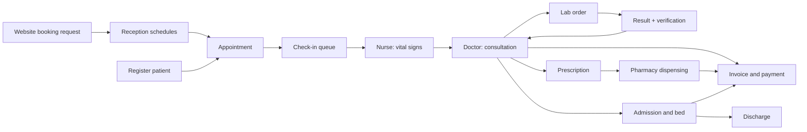

# Injibara General Hospital – Hospital Management System (HMS)

A full-stack, role-based hospital information system for an Ethiopian hospital, with a public website, online appointment requests, and staff modules for patients, appointments, OPD, laboratory, pharmacy, billing (ETB), wards and reports. English and Amharic, with the Ethiopian calendar.

University / internship project by **Melaku Tewachew** · Repository: https://github.com/tewa0121/HOSPITAL-MANAGEMENT-SYSTEM

---

## Features

### Public website (no login)
| Page | What it does |
|---|---|
| Home (`/`) | Hero slider (up to 8 photos), online booking form, services, about, departments, doctors, news, emergency contact, footer |
| About (`/about`) | Mission, vision, values, services, visiting information |
| News & Events (`/news`, `/news/:id`) | Posts managed by staff |
| Patient Portal (`/portal`) | Track an appointment request with **reference code + phone number**. No clinical data is shown |
| Staff Login (`/login`) | Entry point for hospital staff |

### Staff modules
| Area | What it does |
|---|---|
| Access control | 8 roles, 50+ granular permissions stored in the database, per-user overrides, enforced on the server for every request |
| Patients | Registration with Ethiopian name and address format, MRN, duplicate detection, allergies |
| Appointments | Doctor slots with overlap protection, walk-ins, check-in queue, reschedule, no-show |
| Appointment requests | Requests from the website: mark contacted, schedule into a real appointment, or cancel |
| OPD | Vital signs, consultation notes, ICD-10 diagnoses, lab orders, prescriptions with allergy check |
| Laboratory | Sample barcode, automatic normal/high/low/critical flags, separate verification step, rejection with reason |
| Pharmacy | Earliest-expiry-first (FEFO) dispensing in a transaction, partial dispensing, stock, expiry and low-stock alerts |
| Billing (ETB) | Invoices from visits and admissions; cash, Telebirr, CBE Birr, bank transfer; receipts; discounts and refunds by the hospital administrator only; outstanding-balance card |
| Wards | Bed board, admission, transfer, discharge summary, daily notes, bed-day charges, "needs cleaning" → available |
| Reports | Role dashboards, KPI definitions, CSV export, print to PDF |
| News & Events | Staff create, edit, hide or delete public posts |
| Administration | Users, roles and permissions, audit log, hospital settings |

## Technology

- **Frontend:** React 19 (Vite), Tailwind CSS v4, React Router, Axios, react-i18next, react-hot-toast, lucide-react, Recharts
- **Backend:** Node.js, Express, `mysql2`, JWT, bcryptjs, helmet, express-validator, express-rate-limit
- **Database:** MySQL (MAMP), database `hms_db`

## Setup (Windows)

Requirements: Node.js LTS, MAMP (MySQL running), VS Code.

1. **Database.** In phpMyAdmin create `hms_db`, then import the single file `server/database/hms_full_database.sql`.
2. **Backend.**
   ```powershell
   cd server
   Copy-Item .env.example .env
   npm install
   node database/seedUsers.js      # demo staff accounts
   node database/seedDemo.js       # optional demo data
   npm run dev                     # http://localhost:5000
   ```
   `.env`:
   ```env
   PORT=5000
   DB_HOST=127.0.0.1
   DB_PORT=3306            # check the port on the MAMP start page (often 8889)
   DB_USER=root
   DB_PASSWORD=root
   DB_NAME=hms_db
   JWT_SECRET=change_this_to_a_long_random_string
   JWT_EXPIRES_IN=8h
   CLIENT_URL=http://localhost:5173
   ```
3. **Frontend.**
   ```powershell
   cd client
   npm install
   npm run dev                     # http://localhost:5173
   ```
   Vite proxies `/api` to `http://localhost:5000`.
4. **Photos (optional).** Put `hero1.jpg … hero8.jpg` in `client/public/images/`. Missing slides are skipped automatically.

## Demo accounts

Password for all: `Hms@2026`

| Username | Role |
|---|---|
| `superadmin` | Super Administrator |
| `admin` | Hospital Administrator |
| `doctor1`, `doctor2` | Doctor |
| `nurse1` | Nurse |
| `reception1` | Receptionist |
| `lab1` | Laboratory Technician |
| `pharma1` | Pharmacist |
| `cashier1` | Cashier |

Change these passwords before any real use.

## Online appointment flow

1. A visitor opens **Book an Appointment** on the home page and submits the form → gets a **reference code**.
2. Reception opens **Appointment requests**, calls the patient and marks it **Contacted**.
3. Reception finds or registers the patient, picks doctor, date and time, and clicks **Schedule** → a real appointment is created and the request becomes **Scheduled**.
4. The visitor checks the status in the **Patient Portal** with reference code + phone.

## Security

- Every API route checks a permission on the server; hiding buttons in the browser is only convenience.
- User and permissions are re-read from the database on every request, so deactivation or role changes apply immediately.
- Passwords are hashed with bcrypt; 5 wrong passwords lock the account for 15 minutes; temporary passwords must be changed at first login.
- Doctors see only their own visits; the hospital administrator cannot read clinical details.
- Discounts and refunds need their own permission. Money is stored in cents; refunds are negative payment rows.
- Public endpoints are rate-limited and validated; the patient tracker needs reference + phone and shows no clinical data.
- Every important action is written to the audit log; clinical and financial history is never deleted.

## Folder structure

```
HOSPITAL-MANAGEMENT-SYSTEM/
├── client/src/   api · components · context · hooks · locales · pages (public, requests, news, …) · routes · utils
├── server/
│   ├── database/ hms_full_database.sql · seedUsers.js · seedDemo.js
│   └── src/      config · middleware · modules (auth, users, roles, patients, appointments, encounters,
│                 lab, pharmacy, billing, wards, reports, audit, settings, public, requests, news) · utils
└── README.md
```

## Main workflow



## Known limitations

- Not included: insurance claims, radiology, operation theatre, HR/payroll, SMS/email, MFA, FHIR/HL7.
- The allergy check matches drug names and a few families; it is not a full interaction database.
- Single hospital, no offline mode. A real deployment needs HTTPS, backups, and a review of local health-data law.
- Contact phone/email on the public site are placeholders in `client/src/utils/hospital.js`.

## License

Educational project. Add a license of your choice before public reuse.